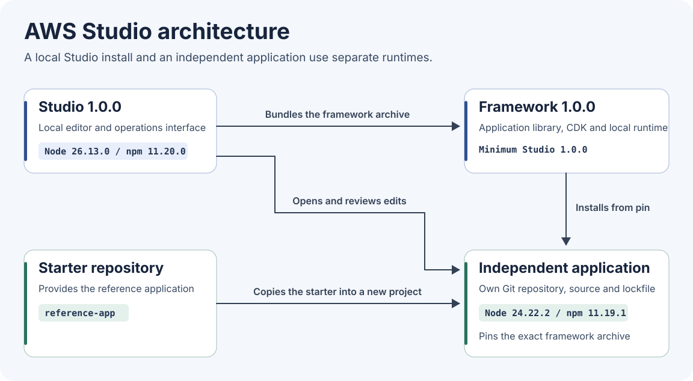

# AWS Studio

AWS Studio is a source-linked editor and operations interface for TypeScript applications
on AWS. The `aws-studio` release contains the framework, CDK constructs, local runtime
servers and command-line tools. Applications declare the resources and workloads that
Studio shows and that the framework runs.

The starter repository includes a reference app with its own source and lockfile. An app installs its declared `aws-studio` release from the vendored archive.
Studio opens a single selected app and uses its physical release to evaluate declarations.
The platform checkout contains Studio and the release source.



[Product and architecture overview](docs/AWS-STUDIO.md) · [Documentation](docs/README.md) · [Knowledge router](docs/aws-studio-knowledge/README.md)

## Install and open Studio

The Studio distribution installs into its own directory from a separate dependency
lock. Studio 1.0.0 uses Node 26.13.0 and npm 11.20.0 or later on those major lines.
An existing project keeps its own toolchain and dependencies. Set
`AWS_STUDIO_PROJECT_NODE` to its absolute Node executable if Studio cannot find the
project toolchain. npm must be installed alongside that executable.

The commands below use locally available runtimes and artifacts. For an offline
install, populate npm's cache for the distribution lock on the intended host. On a
connected first install, omit `--offline` to retrieve locked packages.

```sh
STUDIO_NODE_BIN=/path/to/node-v26.13.0/bin
STUDIO_HOME=/path/to/studio-installs/1.0.0
mkdir -p "$STUDIO_HOME"
tar -xzf /path/to/aws-studio-1.0.0-distribution.tar.gz -C "$STUDIO_HOME"
cd "$STUDIO_HOME/aws-studio"
PATH="$STUDIO_NODE_BIN:$PATH" "$STUDIO_NODE_BIN/npm" ci --offline --no-audit --no-fund
"$STUDIO_NODE_BIN/node" scripts/studio.mjs --version
AWS_STUDIO_PROJECT_NODE=/path/to/node-v24.22.2/bin/node \
  "$STUDIO_NODE_BIN/node" scripts/studio.mjs --project /path/to/project
```

Use the loopback URL printed by Studio. Add `--print` for one snapshot. To update,
install the next distribution in its own versioned directory, install its locked
dependencies and launch it against the same project. Keep the previous directory
and its host runtime to reopen projects within that Studio release's compatibility
window. An explicit reviewed framework upgrade can change a project's framework pin.

### Create an independent project

From the installed Studio directory, supply a new project directory and choose the
project's Node and npm pair. Studio copies the bundled starter, installs its locked
dependencies and initializes its own Git repository. To use a populated npm cache,
set `npm_config_offline=true` for the creation command.

```sh
PROJECT_NODE=/path/to/node-v24.22.2/bin/node
mkdir -p /path/to/projects
AWS_STUDIO_PROJECT_NODE="$PROJECT_NODE" npm_config_offline=true \
  "$STUDIO_NODE_BIN/node" scripts/studio.mjs --create-project /path/to/projects/my-app
AWS_STUDIO_PROJECT_NODE="$PROJECT_NODE" \
  "$STUDIO_NODE_BIN/node" scripts/studio.mjs --project /path/to/projects/my-app
```

Run the second command with any compatible project's path to switch projects.
Create private deployment inputs from **CDK environment files** when a target
needs them. Review dependency and source changes together when adopting a feature
that requires a framework upgrade.

## Run Studio from source

Use Node 24.22.2 or newer on the 24.x line and its bundled npm 11.19.1 or newer on the
11.x line. On Windows, use an unelevated terminal and local NTFS checkouts.
The platform's offline bootstrap reads the generated framework peer from the starter
commit recorded in `scripts/starters.json`. Point `AWS_STUDIO_STARTERS` at a local
copy of the starter Git repository containing that commit. The companion project,
[aws-studio-starter-projects](https://github.com/drmatt13/aws-studio-starter-projects),
is private and requires GitHub access. Clone it alongside Studio to use the paths
in the examples below.
Create or copy the reference application into its own project directory before using
it as a development app.
Omit `--offline` on a connected first install to populate the npm cache.

From the platform checkout on macOS or Linux, with the sibling starter repository
and a populated npm cache:

```sh
SOURCE_NODE_BIN=/path/to/node-v24.22.2/bin
export PATH="$SOURCE_NODE_BIN:$PATH"
export AWS_STUDIO_STARTERS="$(git -C ../aws-studio-starter-projects rev-parse --show-toplevel)"
node scripts/bootstrap-test-peer.mjs
npm ci --offline
npm run studio -- --project /path/to/project
```

From the platform checkout in PowerShell, with the sibling repositories available:

```powershell
$env:AWS_STUDIO_STARTERS = (Resolve-Path '..\aws-studio-starter-projects').Path
node scripts/bootstrap-test-peer.mjs
npm ci --offline
```

In the application directory, run `npm ci --offline` with the npm cache populated.
Then return to the platform checkout and select the application:

```powershell
npm run studio -- --project '..\reference-app'
```

Use the loopback URL printed by Studio. Source review, architecture maps and graph
inspection work without AWS credentials or Docker. Use `--print` alongside
`--project` for one snapshot instead of a server. The application directory can
also be an independent copy of a starter.

[Quick Start](QUICKSTART.md) · [Supported development hosts](docs/DEV-DEPLOYMENT.md#supported-development-hosts)

## Work on an application

Run application commands from the opened application's root. The app owns
`framework.config.ts`, its CDK entry point, workloads, database schema and client.
Read its `AGENTS.md` and the guides under `node_modules/aws-studio/docs/`. The latest
source copies of those guides cover framework declarations, development,
production deployment and typed data features. [Documentation index](docs/README.md)

Studio saves reviewed changes in the selected app. The app's private inputs and
operational state stay with it, including the `.cache/framework-studio/` state
directory. AWS operations require authorization and an AWS profile for the target.
Local application compute uses Docker with Linux containers.

## Work on Studio and the release

| Location | Responsibility |
| --- | --- |
| `client-app/` | Studio UI, local host, source inspection and operational controls |
| `packages/aws-studio/` | Release source, public exports, generic CDK, runtime servers and CLI |
| `scripts/` | Release packaging, test starter selection, dependency bootstrap and lockfile checks |
| `docs/` | Product documentation, package guides and linked source evidence |

```sh
npm run build
npm run verify
npm run pack
```

To build both distributables for Studio 1.0.0, use the source Node/npm pair to
pack the framework and the Studio host pair to pack the installation. Use a new
output directory for each build.

```sh
SOURCE_NODE_BIN=/path/to/node-v24.22.2/bin
STUDIO_NODE_BIN=/path/to/node-v26.13.0/bin
RELEASE_OUT="$(mktemp -d)"
PATH="$SOURCE_NODE_BIN:$PATH" "$SOURCE_NODE_BIN/npm" run pack -- "$RELEASE_OUT"
PATH="$STUDIO_NODE_BIN:$PATH" "$STUDIO_NODE_BIN/npm" run pack:studio -- \
  "$RELEASE_OUT" "$RELEASE_OUT/aws-studio-1.0.0.tgz"
```

The Studio distribution records the version and digest of its bundled framework
and CLI. [Release qualification](docs/aws-studio-knowledge/guides/verification-and-maintenance.md#qualify-studio-and-framework-releases)

Platform integration tests prepare the recorded starter with a physical development
release and use an isolated copy when a test changes app source or state. Run app
generation, deployment and Contract Chain commands inside an independently installed
app. A pending Contract Chain result requires explicit review, and verification
preserves all receipts. Release and fixture checks work offline.

[Repository map](docs/aws-studio-knowledge/REPOSITORY-MAP.md) · [Verification and maintenance](docs/aws-studio-knowledge/guides/verification-and-maintenance.md)
